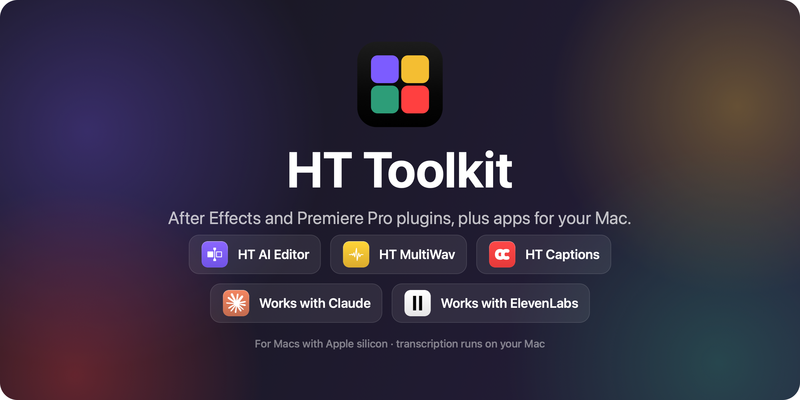
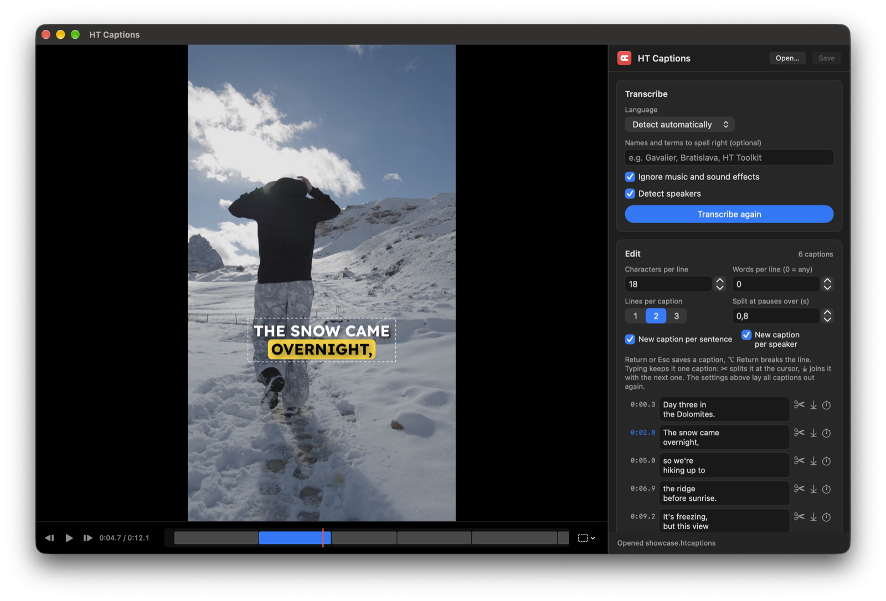
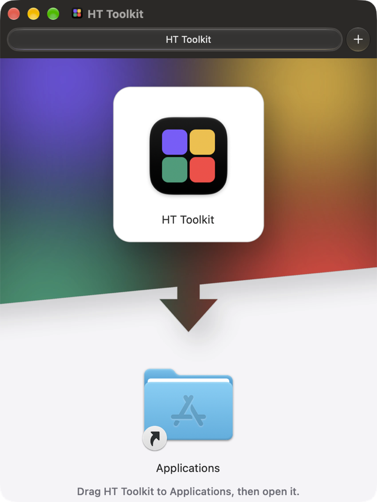
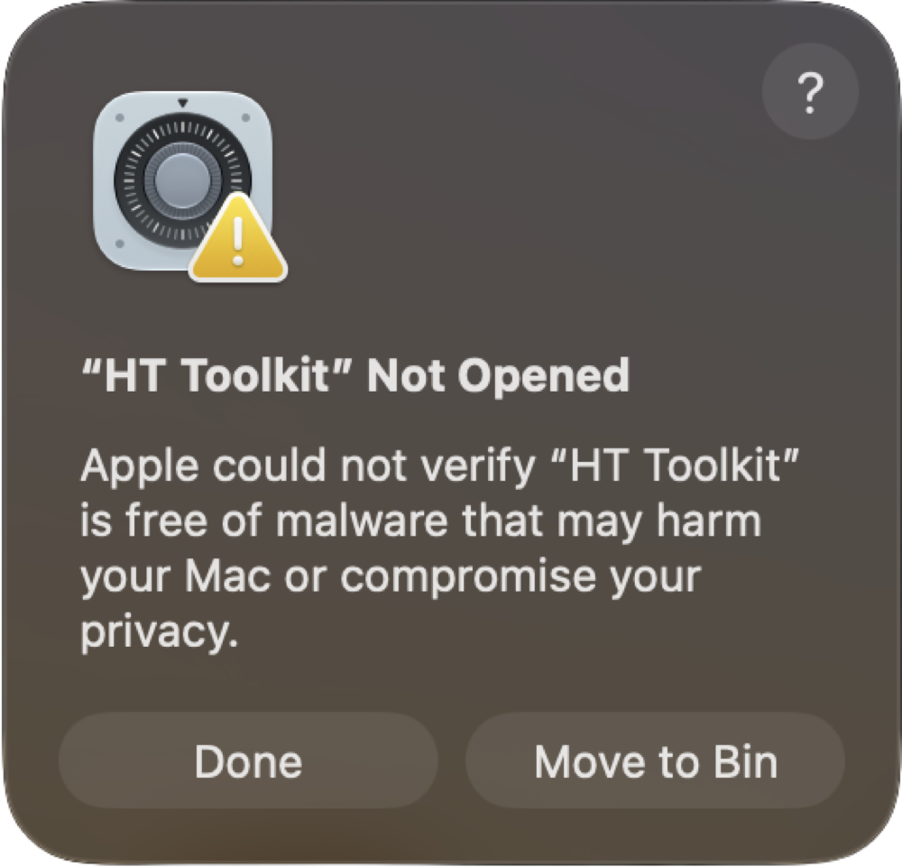
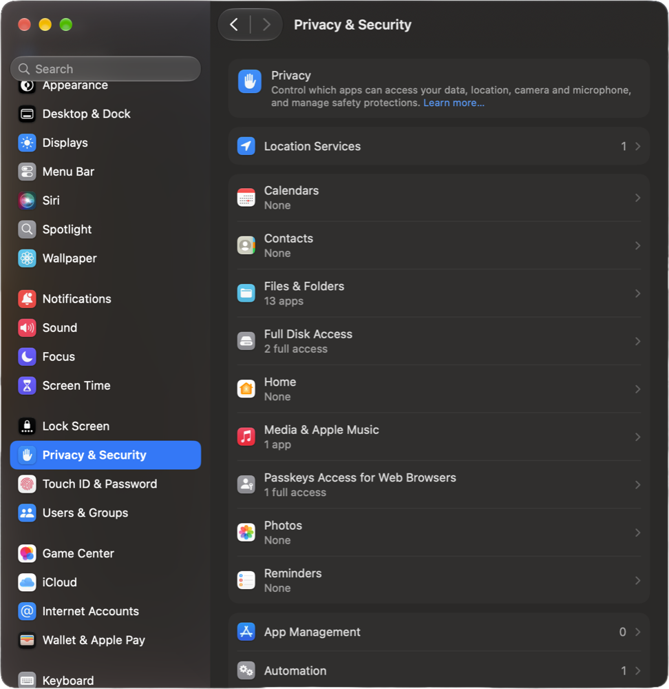
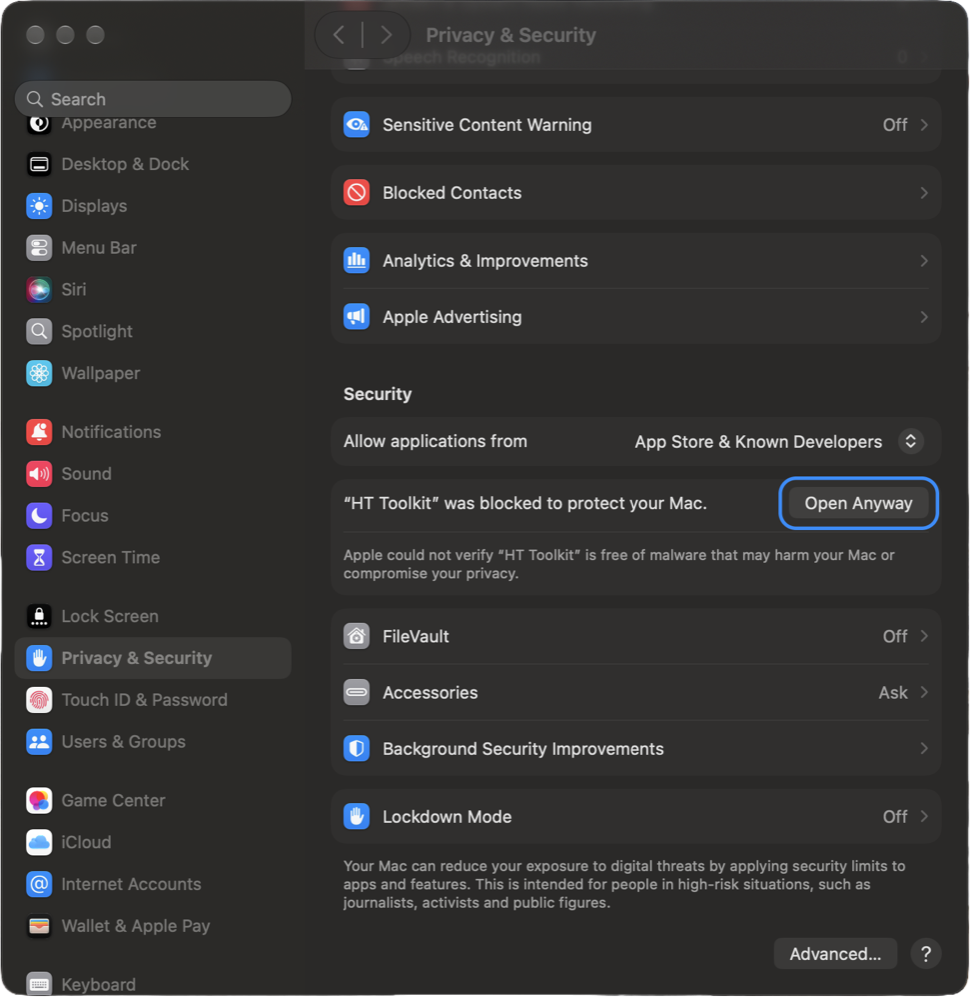
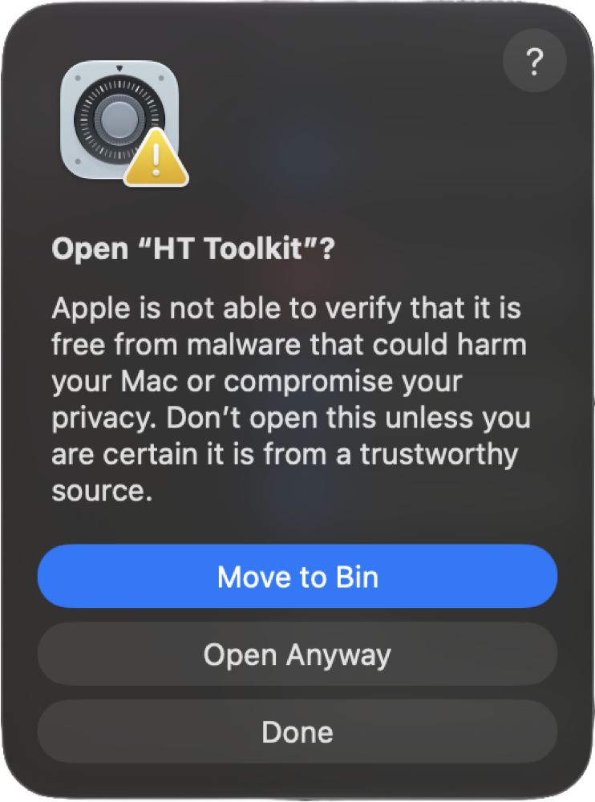

  <a href="https://github.com/gavostar/HT-Toolkit/releases/latest/download/HT-Toolkit.dmg"><b>⬇&nbsp; Download HT Toolkit for Mac</b></a>
  &nbsp;·&nbsp; macOS 14 or later &nbsp;·&nbsp; Apple silicon (M1 and newer)
   One app installs and updates everything below. Free to use.

---

## Plugins

Panels for **After Effects** and **Premiere Pro**. HT Toolkit installs them; open them from **Window › Extensions**.

### &nbsp; HT AI Editor
`After Effects` `Premiere Pro` `Claude`

Lets **Claude** work inside your project: it looks at the timeline and the picture, then cuts, trims, removes silences, adds effects, colour, text, keyframes and markers, sets audio levels, exports and reframes. It can **transcribe your timeline on your Mac** to cut by what is said or line shots up with a voiceover. Every change can be undone.

### &nbsp; HT Captions
`After Effects` `Premiere Pro`

Animated captions in any language, transcribed on your Mac with word-level timing. It can ignore music and sound effects and tell speakers apart. Six animations: static, word highlight, pop-in, karaoke, bounce and typewriter. Add a box behind the lines or the spoken word, a stroke, a shadow or motion blur, then save your looks. In After Effects the captions are one precomp, and in Premiere one nested sequence, so you move them as a single piece.

### &nbsp; HT MultiWav
`After Effects` `Premiere Pro`

Paste a YouTube, Spotify, Instagram or TikTok link and get WAV, MP3 or MP4, imported straight into a bin. Videos are converted so Premiere can edit them.

## Apps

Mac apps that work on their own, no Adobe app needed. Install them from the **Apps** section of HT Toolkit.

### &nbsp; HT Captions
`Mac app`

The same captions for any **finished video**. Drop a video in, edit the words and their timing, pick a look and drag the captions where you want them. Safe-zone guides for TikTok, Reels and Shorts help with placement. Then export:
- an **MP4** (H.264 + AAC) that plays on Mac, Windows, phones and the web
- or the **captions alone** as a transparent ProRes 4444 overlay
- or an **SRT** subtitle file

## Ask Claude to edit for you

Install **HT AI Editor**, connect it to [Claude](https://claude.ai/download) from HT Toolkit, keep the panel open (**Window › Extensions › HT AI Editor**), and ask in plain words. A few things people ask:

| | Try asking |
|---|---|
| ✂️ **Cut by what's said** | *"Transcribe my sequence and cut out the retakes, the ums and pauses longer than half a second."* |
| 🎙️ **Match a voiceover** | *"Lay the B-roll from the B-roll bin over my voiceover so each shot lands on the words it shows."* |
| 🔇 **Clean up silences** | *"Remove every silence longer than 0.6 s on the interview track."* |
| 🎬 **Rough cut** | *"Make a 60-second teaser from the footage in this project. Show me the plan first."* |
| 🎨 **Colour match** | *"Match the colour of every clip to the first shot on V1."* |
| 📱 **Make it vertical** | *"Make a 9:16 version of this sequence and keep the speaker in frame."* |
| ⭐ **Highlights** | *"Find the three best 45-second moments for reels."* |
| 🔎 **Find a moment** | *"Where does she say 'pricing'? Put a marker there."* |

These are also built-in prompts in the HT AI Editor panel (copy them with one click), and in Claude's prompt menu.

## Install

HT Toolkit isn't from the App Store, so the first time you open it macOS asks you to confirm it. That takes a minute, once. Updates open normally.

### 1. Drag HT Toolkit into Applications
Download **[HT-Toolkit.dmg](https://github.com/gavostar/HT-Toolkit/releases/latest/download/HT-Toolkit.dmg)**, open it and drag **HT Toolkit** onto **Applications**.

### 2. Open it and click Done
Open **HT Toolkit** from Applications. macOS says it couldn't verify the app: click **Done**, not *Move to Bin*.

### 3. Go to Privacy & Security
Open **System Settings** and choose **Privacy & Security** in the sidebar.

### 4. Click Open Anyway
Scroll down to **Security**. Next to *"HT Toolkit" was blocked to protect your Mac*, click **Open Anyway**.

### 5. Confirm
Click **Open Anyway** once more, then enter your password or use Touch ID. HT Toolkit opens, and from now on it opens like any other app.

### 6. Install the plugins and apps
In HT Toolkit:
- Pick **After Effects** or **Premiere Pro** and click **Install All**. Restart that app and open the panels from **Window › Extensions**.
- For HT AI Editor, open **Claude** and click **Connect** for each app. Claude asks you to confirm.
- For the HT Captions app, click **Install** under **Apps**.

The first transcription downloads the speech models (about 3 GB) once.

## Updates

HT Toolkit checks for new versions itself and shows **Update** when one is out. The panels show a notice too. **Update All** updates the plugins, the Claude connectors and the HT Captions app in one go.

## Languages

English, Deutsch, Slovenčina, Čeština, Magyar and Español. Pick yours at the top of HT Toolkit, and every panel and the HT Captions app follow it. Captions can be made in any language Whisper knows.

## Privacy

Transcription, voice isolation and captions run **on your Mac**, and your media is never uploaded. HT AI Editor talks to Claude only when you ask Claude to edit, through the Claude app you're signed in to. HT MultiWav downloads only the links you paste.

## Uninstall

In HT Toolkit, open a plugin and click **Uninstall**, or the HT Captions app and **Uninstall**. Then delete HT Toolkit from Applications. Models and settings live in `~/Library/Application Support/HT Toolkit`.

---

HT Toolkit is made by Gabriel Gavalier. Adobe, After Effects and Premiere Pro are trademarks of Adobe; Claude is a trademark of Anthropic. HT Toolkit isn't affiliated with either.
